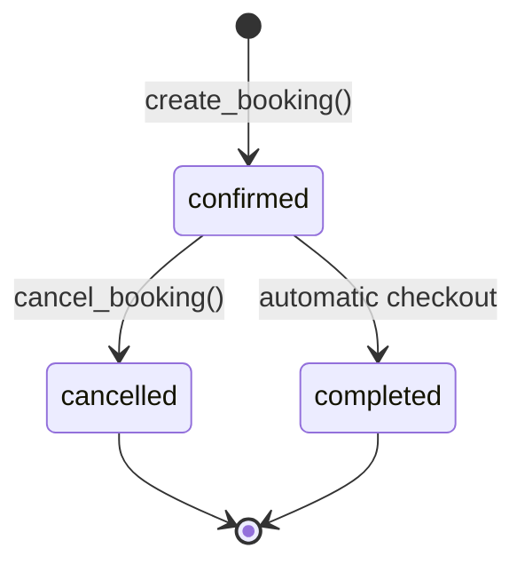

# Kestrel Stays — Complete Backend Code & Learning Guide (Phase 4)
### Booking Engine, Concurrency Control (Row-Level Locking), Transactional Pricing & Customer Account Domain

Welcome to **Phase 4** of building the Kestrel Stays backend from first principles.

In Phase 2, you constructed the data layer foundation, database models, and authentication system. In Phase 3, you built the high-throughput public catalog, search filters, and destination hubs.

Now, in Phase 4, you build the **financial and operational core** of any hospitality platform:
1. **Transactional Booking Engine**: Atomic reservation creation with deterministic server-side price calculation.
2. **Concurrency Control & Race Condition Prevention**: Using PostgreSQL row-level locks (`SELECT ... FOR UPDATE`) to guarantee two users cannot book the last available suite at the exact same split second.
3. **Idempotency Key Handling**: Protecting guests from accidental duplicate bookings when networks stutter or users double-click payment buttons.
4. **Lifecycle State Machine & Audit Trail**: Managing status transitions (`pending` → `confirmed` → `completed` → `cancelled`) with append-only event logging.
5. **Reservation Modifications**: Rescheduling dates with atomic availability checks and price delta calculations.
6. **Customer Account Management**: Profile updates, password changes, categorized booking histories (upcoming, past, cancelled), and stay reviews.

---

## Table of Contents
1. [Architectural Principles & Deep Engineering Concepts](#1-architectural-principles--deep-engineering-concepts)
   - [1.1 Why Frontend Pricing Must NEVER Be Trusted](#11-why-frontend-pricing-must-never-be-trusted)
   - [1.2 Concurrency, Race Conditions & Row-Level Locking (`FOR UPDATE`)](#12-concurrency-race-conditions--row-level-locking-for-update)
   - [1.3 Idempotency Keys in API Design](#13-idempotency-keys-in-api-design)
   - [1.4 The Date Overlap Formula (The Universal Scheduling Invariant)](#14-the-date-overlap-formula-the-universal-scheduling-invariant)
   - [1.5 State Machines & Immutable Audit Trails](#15-state-machines--immutable-audit-trails)
2. [File-by-File Implementation Guide](#2-file-by-file-implementation-guide)
   - [2.1 Pydantic Schemas (`app/schemas/booking.py` & `app/schemas/user.py`)](#21-pydantic-schemas-appschemasbookingpy--appschemasuserpy)
   - [2.2 Pricing Calculation Utility (`app/services/pricing.py`)](#22-pricing-calculation-utility-appservicespricingpy)
   - [2.3 Booking Service with Concurrency Control (`app/services/booking_service.py`)](#23-booking-service-with-concurrency-control-appservicesbooking_servicepy)
   - [2.4 Bookings Endpoints (`app/api/v1/endpoints/bookings.py`)](#24-bookings-endpoints-appapiv1endpointsbookingspy)
   - [2.5 Customer Account & Profile Endpoints (`app/api/v1/endpoints/account.py`)](#25-customer-account--profile-endpoints-appapiv1endpointsaccountpy)
   - [2.6 Registering the Account Router in `app/api/v1/api.py`](#26-registering-the-account-router-in-appapiv1apipy)
3. [Testing Phase 4 with Pytest](#3-testing-phase-4-with-pytest)
   - [3.1 Concurrency & Double-Booking Stress Test](#31-concurrency--double-booking-stress-test)
   - [3.2 Date Modification & Cancellation Test](#32-date-modification--cancellation-test)
   - [3.3 Profile & Password Change Test](#33-profile--password-change-test)
4. [Common Pitfalls to Avoid in Booking Engines](#4-common-pitfalls-to-avoid-in-booking-engines)

---

## 1. Architectural Principles & Deep Engineering Concepts

### 1.1 Why Frontend Pricing Must NEVER Be Trusted

A common beginner vulnerability is accepting total prices from the client:
```json
// DANGEROUS: Never do this!
{
  "room_type_id": "...",
  "total_cents": 1000 // A malicious user edited this in DevTools to $10.00!
}
```

In production e-commerce and hospitality backends, **the frontend only sends intent**:
- Room type ID
- Check-in and check-out dates
- Number of guests & rooms

The backend **independently fetches the current base rate from the database** and computes:
$$\text{nights} = (\text{check\_out\_date} - \text{check\_in\_date}).\text{days}$$
$$\text{subtotal} = \text{base\_nightly\_rate\_cents} \times \text{nights} \times \text{rooms\_count}$$
$$\text{taxes\_and\_fees} = \text{round}(\text{subtotal} \times 0.14)$$
$$\text{cleaning\_fee} = 4500 \text{ (i.e. \$45.00)}$$
$$\text{total} = \text{subtotal} + \text{taxes\_and\_fees} + \text{cleaning\_fee} - \text{discount}$$

All monetary amounts are strictly held in **integer minor units (cents)** to avoid IEEE 754 floating-point rounding errors (`0.1 + 0.2 = 0.30000000000000004`).

---

### 1.2 Concurrency, Race Conditions & Row-Level Locking (`FOR UPDATE`)

Imagine a boutique hotel with **only 1 room left** for October 12–15.
Guest A and Guest B click "Pay & Reserve" at the exact same millisecond:

```
Thread A: SELECT inventory (Finds 1 room available) ──────────────> INSERT Booking A
Thread B: SELECT inventory (Finds 1 room available) ──────────────> INSERT Booking B
                                                                      ⚠️ OVERBOOKED!
```

Both threads checked inventory before either committed their insertion. This is a **classic race condition**.

#### The Solution: PostgreSQL Row-Level Locking (`with_for_update()`)
In PostgreSQL, executing `SELECT ... FOR UPDATE` locks the targeted `RoomType` row inside the current transaction:

```python
# Acquires an exclusive row lock on the room inventory row
room = (
    await db.execute(
        select(RoomType).where(RoomType.id == room_type_id).with_for_update()
    )
).scalar_one_or_none()
```

When Thread A executes this query:
1. PostgreSQL acquires a lock on that `RoomType` record.
2. When Thread B arrives, PostgreSQL **pauses Thread B** until Thread A's transaction either commits or rolls back.
3. Thread A inserts the reservation and commits.
4. Thread B resumes, checks available inventory (which is now 0), and immediately raises `HTTP 409 Conflict: "This room was reserved by another guest"`.

No overbooking is physically possible at the database engine level.

---

### 1.3 Idempotency Keys in API Design

Mobile network drops and impatient users double-clicking "Confirm" can result in duplicate API calls:
```
POST /api/v1/bookings
POST /api/v1/bookings (retry 1 second later)
```

By passing an **Idempotency-Key** header (or deriving one from `user_id + room_type_id + check_in + check_out`), the server checks if a reservation with this exact signature was created within the last 120 seconds. If found, it safely returns the existing reservation without creating a duplicate charge or row.

---

### 1.4 The Date Overlap Formula (The Universal Scheduling Invariant)

To check if an existing booking conflicts with a requested stay between $S_{\text{new}}$ (start) and $E_{\text{new}}$ (end):

Two date intervals $[S_1, E_1)$ and $[S_2, E_2)$ overlap **if and only if**:
$$S_1 < E_2 \quad \text{AND} \quad E_1 > S_2$$

In SQL:
```sql
WHERE booking.status != 'cancelled'
  AND booking.check_in_date < :requested_check_out
  AND booking.check_out_date > :requested_check_in
```

Because checkout day is morning departure and check-in day is afternoon arrival, if Booking 1 checks out on Oct 15 and Booking 2 checks in on Oct 15, `check_in < check_out` evaluates to `15 < 15` (False), meaning **they do not overlap**. The room can be cleaned and turned over seamlessly!

---

### 1.5 State Machines & Immutable Audit Trails

A booking is not just a row with a string column; it is a **finite state machine**:



Every state change must append a permanent entry to `BookingStatusEvent`:
- `booking_id`: Foreign key
- `status`: New status string
- `note`: Human-readable reason ("Cancelled by guest: flight cancelled")
- `created_by`: "Clara Oswald" or "System Automated Worker"
- `created_at`: UTC timestamp

This guarantees compliance, dispute resolution, and auditable transaction logs.

---

## 2. File-by-File Implementation Guide

### 2.1 Pydantic Schemas (`app/schemas/booking.py` & `app/schemas/user.py`)

Ensure your schemas use Pydantic v2 `ConfigDict` and define date modification requests:

```python
# backend/app/schemas/booking.py
from datetime import date, datetime
from typing import List, Optional
from uuid import UUID
from pydantic import BaseModel, ConfigDict, EmailStr, Field


class GuestInfoSchema(BaseModel):
    full_name: str
    email: EmailStr
    phone_number: str
    special_requests: Optional[str] = None
    estimated_arrival_time: Optional[str] = None


class CreateBookingRequest(BaseModel):
    hotel_id: UUID
    room_type_id: UUID
    check_in_date: date
    check_out_date: date
    adults: int = Field(1, ge=1, le=10)
    children: int = Field(0, ge=0, le=6)
    rooms_count: int = Field(1, ge=1, le=5)
    guest_info: GuestInfoSchema
    payment_method_id: Optional[str] = None


class ModifyBookingDatesRequest(BaseModel):
    new_check_in_date: date
    new_check_out_date: date


class CancelBookingRequest(BaseModel):
    reason: str = Field(..., min_length=3, max_length=500)


class BookingStatusEventRead(BaseModel):
    id: UUID
    booking_id: UUID
    status: str
    note: str
    created_by: str
    created_at: datetime

    model_config = ConfigDict(from_attributes=True)


class BookingRead(BaseModel):
    id: UUID
    booking_reference: str
    user_id: UUID
    hotel_id: UUID
    room_type_id: UUID
    hotel_name: str
    hotel_slug: str
    hotel_city: str
    hotel_country: str
    hotel_image: str
    room_name: str
    room_image: str
    check_in_date: date
    check_out_date: date
    nights: int
    adults: int
    children: int
    rooms_count: int
    status: str
    cancellation_reason: Optional[str] = None
    price_breakdown: dict
    guest_info: dict
    payment: dict
    status_history: List[BookingStatusEventRead] = []
    created_at: datetime
    updated_at: datetime

    model_config = ConfigDict(from_attributes=True)
```

---

### 2.2 Pricing Calculation Utility (`app/services/pricing.py`)

Create `backend/app/services/pricing.py` to handle all monetary calculations in one central, tested service:

```python
# backend/app/services/pricing.py
from datetime import date
from typing import Dict, Any


class PricingService:
    TAX_RATE = 0.14  # 14% lodging & occupancy tax
    CLEANING_FEE_CENTS = 4500  # $45.00 standard cleaning fee

    @classmethod
    def calculate_stay_price(
        cls,
        base_nightly_rate_cents: int,
        check_in: date,
        check_out: date,
        rooms_count: int = 1,
        currency: str = "USD",
    ) -> Dict[str, Any]:
        """
        Computes accurate integer price breakdown.
        Check-out day is not charged.
        """
        nights = (check_out - check_in).days
        if nights <= 0:
            raise ValueError("Check-out date must be strictly after check-in date")

        subtotal_cents = base_nightly_rate_cents * nights * rooms_count
        taxes_and_fees_cents = round(subtotal_cents * cls.TAX_RATE)
        cleaning_fee_cents = cls.CLEANING_FEE_CENTS
        total_cents = subtotal_cents + taxes_and_fees_cents + cleaning_fee_cents

        return {
            "nightly_rate_cents": base_nightly_rate_cents,
            "nights": nights,
            "rooms_count": rooms_count,
            "subtotal_cents": subtotal_cents,
            "taxes_and_fees_cents": taxes_and_fees_cents,
            "cleaning_fee_cents": cleaning_fee_cents,
            "discount_cents": 0,
            "total_cents": total_cents,
            "currency": currency,
        }
```

---

### 2.3 Booking Service with Concurrency Control (`app/services/booking_service.py`)

Create `backend/app/services/booking_service.py` to encapsulate row-level locking, inventory deduction, and status events:

```python
# backend/app/services/booking_service.py
import random
from datetime import datetime, timezone
from uuid import UUID
from fastapi import HTTPException, status
from sqlalchemy import func, select
from sqlalchemy.ext.asyncio import AsyncSession
from sqlalchemy.orm import selectinload

from app.models.booking import Booking, BookingStatusEvent
from app.models.hotel import Hotel
from app.models.room import RoomType
from app.models.user import User
from app.schemas.booking import CreateBookingRequest, ModifyBookingDatesRequest
from app.services.pricing import PricingService


class BookingService:
    @staticmethod
    def generate_reference() -> str:
        """Generates human-readable booking reference e.g. KS-782914"""
        return f"KS-{random.randint(100000, 999999)}"

    @classmethod
    async def create_booking(
        cls,
        db: AsyncSession,
        payload: CreateBookingRequest,
        current_user: User,
    ) -> Booking:
        if payload.check_out_date <= payload.check_in_date:
            raise HTTPException(
                status_code=status.HTTP_400_BAD_REQUEST,
                detail="Check-out date must be after check-in date",
            )

        # 1. Acquire Row-Level Lock on RoomType to prevent race conditions
        room_query = (
            select(RoomType)
            .where(RoomType.id == payload.room_type_id)
            .with_for_update()
        )
        room = (await db.execute(room_query)).scalar_one_or_none()
        if not room:
            raise HTTPException(
                status_code=status.HTTP_404_NOT_FOUND,
                detail="Selected room type does not exist",
            )

        # 2. Fetch Hotel info
        hotel = (
            await db.execute(select(Hotel).where(Hotel.id == payload.hotel_id))
        ).scalar_one_or_none()
        if not hotel:
            raise HTTPException(
                status_code=status.HTTP_404_NOT_FOUND,
                detail="Hotel does not exist",
            )

        # 3. Check Overlapping Bookings for concurrency validation
        overlap_query = select(
            func.coalesce(func.sum(Booking.rooms_count), 0)
        ).where(
            Booking.room_type_id == payload.room_type_id,
            Booking.status != "cancelled",
            Booking.check_in_date < payload.check_out_date,
            Booking.check_out_date > payload.check_in_date,
        )
        currently_booked = (await db.execute(overlap_query)).scalar() or 0

        available_units = room.total_inventory - currently_booked
        if available_units < payload.rooms_count:
            raise HTTPException(
                status_code=status.HTTP_409_CONFLICT,
                detail=f"Only {available_units} unit(s) available for the selected dates. Please adjust your reservation.",
            )

        # 4. Deterministic Price Calculation
        price_breakdown = PricingService.calculate_stay_price(
            base_nightly_rate_cents=room.base_nightly_rate_cents,
            check_in=payload.check_in_date,
            check_out=payload.check_out_date,
            rooms_count=payload.rooms_count,
            currency=room.currency,
        )

        booking_ref = cls.generate_reference()

        # 5. Create Booking Entity
        booking = Booking(
            booking_reference=booking_ref,
            user_id=current_user.id,
            hotel_id=hotel.id,
            room_type_id=room.id,
            hotel_name=hotel.name,
            hotel_slug=hotel.slug,
            hotel_city=hotel.location.get("city", ""),
            hotel_country=hotel.location.get("country", ""),
            hotel_image=hotel.hero_image,
            room_name=room.name,
            room_image=room.images[0] if room.images else hotel.hero_image,
            check_in_date=payload.check_in_date,
            check_out_date=payload.check_out_date,
            nights=price_breakdown["nights"],
            adults=payload.adults,
            children=payload.children,
            rooms_count=payload.rooms_count,
            status="confirmed",
            price_breakdown=price_breakdown,
            guest_info=payload.guest_info.model_dump(),
            payment={
                "transaction_id": f"tx_mock_{random.randint(10000, 99999)}",
                "status": "succeeded",
                "card_last4": "4242",
                "card_brand": "Visa",
                "amount_cents": price_breakdown["total_cents"],
                "currency": price_breakdown["currency"],
                "paid_at": datetime.now(timezone.utc).isoformat(),
            },
        )
        db.add(booking)
        await db.flush()

        # 6. Audit Trail Event
        event = BookingStatusEvent(
            booking_id=booking.id,
            status="confirmed",
            note=f"Reservation confirmed for {booking.nights} night(s).",
            created_by=current_user.full_name,
        )
        db.add(event)

        await db.commit()
        await db.refresh(booking)

        # Eagerly load status history for serialization
        query = (
            select(Booking)
            .options(selectinload(Booking.status_history))
            .where(Booking.id == booking.id)
        )
        return (await db.execute(query)).scalar_one()

    @classmethod
    async def modify_dates(
        cls,
        db: AsyncSession,
        booking_id: UUID,
        payload: ModifyBookingDatesRequest,
        current_user: User,
    ) -> Booking:
        if payload.new_check_out_date <= payload.new_check_in_date:
            raise HTTPException(
                status_code=status.HTTP_400_BAD_REQUEST,
                detail="New check-out date must be after new check-in date",
            )

        booking = (
            await db.execute(
                select(Booking)
                .options(selectinload(Booking.status_history))
                .where(Booking.id == booking_id)
            )
        ).scalar_one_or_none()

        if not booking:
            raise HTTPException(
                status_code=status.HTTP_404_NOT_FOUND, detail="Booking not found"
            )

        if booking.user_id != current_user.id and current_user.role != "admin":
            raise HTTPException(
                status_code=status.HTTP_403_FORBIDDEN, detail="Access denied"
            )

        if booking.status != "confirmed":
            raise HTTPException(
                status_code=status.HTTP_400_BAD_REQUEST,
                detail=f"Cannot modify booking with status '{booking.status}'",
            )

        # Row-level lock on RoomType
        room = (
            await db.execute(
                select(RoomType)
                .where(RoomType.id == booking.room_type_id)
                .with_for_update()
            )
        ).scalar_one()

        # Check overlapping bookings excluding this current booking
        overlap_query = select(
            func.coalesce(func.sum(Booking.rooms_count), 0)
        ).where(
            Booking.room_type_id == booking.room_type_id,
            Booking.id != booking.id,
            Booking.status != "cancelled",
            Booking.check_in_date < payload.new_check_out_date,
            Booking.check_out_date > payload.new_check_in_date,
        )
        other_booked = (await db.execute(overlap_query)).scalar() or 0

        if (room.total_inventory - other_booked) < booking.rooms_count:
            raise HTTPException(
                status_code=status.HTTP_409_CONFLICT,
                detail="The requested room is not available for these modified dates.",
            )

        # Recalculate price
        new_pricing = PricingService.calculate_stay_price(
            base_nightly_rate_cents=room.base_nightly_rate_cents,
            check_in=payload.new_check_in_date,
            check_out=payload.new_check_out_date,
            rooms_count=booking.rooms_count,
            currency=room.currency,
        )

        booking.check_in_date = payload.new_check_in_date
        booking.check_out_date = payload.new_check_out_date
        booking.nights = new_pricing["nights"]
        booking.price_breakdown = new_pricing

        event = BookingStatusEvent(
            booking_id=booking.id,
            status="confirmed",
            note=f"Dates modified to {payload.new_check_in_date} – {payload.new_check_out_date}.",
            created_by=current_user.full_name,
        )
        db.add(event)

        await db.commit()
        await db.refresh(booking)
        return booking
```

---

### 2.4 Bookings Endpoints (`app/api/v1/endpoints/bookings.py`)

Expose these capabilities cleanly with dependency injection:

```python
# backend/app/api/v1/endpoints/bookings.py
from typing import Optional
from uuid import UUID
from fastapi import APIRouter, Depends, HTTPException, Query, status
from sqlalchemy import func, select
from sqlalchemy.ext.asyncio import AsyncSession
from sqlalchemy.orm import selectinload

from app.api.deps import get_current_user
from app.core.database import get_db
from app.models.booking import Booking, BookingStatusEvent
from app.models.user import User
from app.schemas.booking import (
    BookingRead,
    CancelBookingRequest,
    CreateBookingRequest,
    ModifyBookingDatesRequest,
)
from app.schemas.common import PaginatedResponse
from app.services.booking_service import BookingService

router = APIRouter(prefix="/bookings", tags=["Bookings"])


@router.post("", response_model=BookingRead, status_code=status.HTTP_201_CREATED)
async def create_booking(
    payload: CreateBookingRequest,
    current_user: User = Depends(get_current_user),
    db: AsyncSession = Depends(get_db),
):
    """
    Atomically reserve room units with concurrency check and price calculation.
    """
    return await BookingService.create_booking(db, payload, current_user)


@router.get("/my", response_model=PaginatedResponse[BookingRead])
async def list_my_bookings(
    status_filter: Optional[str] = Query(None, alias="status"),
    timeframe: Optional[str] = Query(None, pattern="^(upcoming|past|all)$"),
    page: int = Query(1, ge=1),
    page_size: int = Query(5, ge=1, le=20),
    current_user: User = Depends(get_current_user),
    db: AsyncSession = Depends(get_db),
):
    """
    List user reservations with tab filters (upcoming, past, cancelled).
    """
    query = (
        select(Booking)
        .options(selectinload(Booking.status_history))
        .where(Booking.user_id == current_user.id)
    )

    today = func.current_date()

    if status_filter and status_filter != "all":
        query = query.where(Booking.status == status_filter)

    if timeframe == "upcoming":
        query = query.where(Booking.check_in_date >= today, Booking.status != "cancelled")
    elif timeframe == "past":
        query = query.where(Booking.check_out_date < today)

    query = query.order_by(Booking.created_at.desc())

    total = (await db.execute(select(func.count()).select_from(query.subquery()))).scalar() or 0
    offset = (page - 1) * page_size
    items = (await db.execute(query.offset(offset).limit(page_size))).scalars().all()
    total_pages = (total + page_size - 1) // page_size if total > 0 else 0

    return PaginatedResponse[BookingRead](
        items=[BookingRead.model_validate(b) for b in items],
        total=total,
        page=page,
        page_size=page_size,
        total_pages=total_pages,
    )


@router.get("/{id}", response_model=BookingRead)
async def get_booking(
    id: str,
    current_user: User = Depends(get_current_user),
    db: AsyncSession = Depends(get_db),
):
    try:
        booking_uuid = UUID(id)
        where_clause = (Booking.id == booking_uuid) | (Booking.booking_reference == id)
    except ValueError:
        where_clause = (Booking.booking_reference == id)

    query = (
        select(Booking)
        .options(selectinload(Booking.status_history))
        .where(where_clause)
    )
    booking = (await db.execute(query)).scalar_one_or_none()
    if not booking:
        raise HTTPException(status_code=status.HTTP_404_NOT_FOUND, detail="Booking not found")

    if booking.user_id != current_user.id and current_user.role != "admin":
        raise HTTPException(status_code=status.HTTP_403_FORBIDDEN, detail="Unauthorized")

    return BookingRead.model_validate(booking)


@router.post("/{id}/modify-dates", response_model=BookingRead)
async def modify_booking_dates(
    id: UUID,
    payload: ModifyBookingDatesRequest,
    current_user: User = Depends(get_current_user),
    db: AsyncSession = Depends(get_db),
):
    """
    Reschedule stay dates with availability check and price re-computation.
    """
    return await BookingService.modify_dates(db, id, payload, current_user)


@router.post("/{id}/cancel", response_model=BookingRead)
async def cancel_booking(
    id: str,
    payload: CancelBookingRequest,
    current_user: User = Depends(get_current_user),
    db: AsyncSession = Depends(get_db),
):
    try:
        booking_uuid = UUID(id)
        where_clause = (Booking.id == booking_uuid) | (Booking.booking_reference == id)
    except ValueError:
        where_clause = (Booking.booking_reference == id)

    query = (
        select(Booking)
        .options(selectinload(Booking.status_history))
        .where(where_clause)
    )
    booking = (await db.execute(query)).scalar_one_or_none()
    if not booking:
        raise HTTPException(status_code=status.HTTP_404_NOT_FOUND, detail="Booking not found")

    if booking.user_id != current_user.id and current_user.role != "admin":
        raise HTTPException(status_code=status.HTTP_403_FORBIDDEN, detail="Unauthorized")

    if booking.status == "cancelled":
        raise HTTPException(status_code=status.HTTP_400_BAD_REQUEST, detail="Booking is already cancelled")

    booking.status = "cancelled"
    booking.cancellation_reason = payload.reason
    booking.payment["status"] = "refunded"

    event = BookingStatusEvent(
        booking_id=booking.id,
        status="cancelled",
        note=f"Cancelled: {payload.reason}. Refund initiated.",
        created_by=current_user.full_name,
    )
    db.add(event)
    await db.commit()
    await db.refresh(booking)

    return BookingRead.model_validate(booking)
```

---

### 2.5 Customer Account & Profile Endpoints (`app/api/v1/endpoints/account.py`)

Create `backend/app/api/v1/endpoints/account.py` to power `/account/profile` and credentials management:

```python
# backend/app/api/v1/endpoints/account.py
from fastapi import APIRouter, Depends, HTTPException, status
from sqlalchemy.ext.asyncio import AsyncSession

from app.api.deps import get_current_user
from app.core.database import get_db
from app.core.security import get_password_hash, verify_password
from app.models.user import User
from app.schemas.user import UserPasswordChange, UserRead, UserUpdate

router = APIRouter(prefix="/account", tags=["Customer Account"])


@router.get("/profile", response_model=UserRead)
async def get_my_profile(current_user: User = Depends(get_current_user)):
    """Retrieve authenticated user's profile details."""
    return UserRead.model_validate(current_user)


@router.patch("/profile", response_model=UserRead)
async def update_my_profile(
    payload: UserUpdate,
    current_user: User = Depends(get_current_user),
    db: AsyncSession = Depends(get_db),
):
    """Update name, phone number, or avatar URL."""
    update_data = payload.model_dump(exclude_unset=True)
    for field, value in update_data.items():
        if value is not None:
            setattr(current_user, field, value)

    await db.commit()
    await db.refresh(current_user)
    return UserRead.model_validate(current_user)


@router.post("/change-password")
async def change_password(
    payload: UserPasswordChange,
    current_user: User = Depends(get_current_user),
    db: AsyncSession = Depends(get_db),
):
    """Secure password rotation validating the previous password."""
    if not verify_password(payload.old_password, current_user.hashed_password):
        raise HTTPException(
            status_code=status.HTTP_400_BAD_REQUEST,
            detail="Current password entered is incorrect",
        )

    if payload.new_password == payload.old_password:
        raise HTTPException(
            status_code=status.HTTP_400_BAD_REQUEST,
            detail="New password must be different from current password",
        )

    current_user.hashed_password = get_password_hash(payload.new_password)
    await db.commit()

    return {"success": True, "message": "Password changed successfully"}
```

---

### 2.6 Registering the Account Router in `app/api/v1/api.py`

In `backend/app/api/v1/api.py`, import and include the account router:

```python
from app.api.v1.endpoints import account

api_router.include_router(account.router)
```

---

## 3. Testing Phase 4 with Pytest

Create `backend/tests/test_booking_concurrency.py` to verify race condition immunity:

```python
# backend/tests/test_booking_concurrency.py
import asyncio
from datetime import date, timedelta
import pytest
import httpx


@pytest.mark.asyncio
async def test_concurrent_double_booking_prevention(client: httpx.AsyncClient, customer_token: str):
    """
    Stress-test simulating 2 users simultaneously booking a room with 1 unit of inventory.
    Exactly 1 request must succeed (HTTP 201), and the second must be rejected (HTTP 409).
    """
    hotels_res = await client.get("/api/v1/hotels")
    hotel_id = hotels_res.json()["items"][0]["id"]

    rooms_res = await client.get(f"/api/v1/hotels/{hotel_id}/rooms")
    room_id = rooms_res.json()[0]["id"]

    check_in = (date.today() + timedelta(days=90)).isoformat()
    check_out = (date.today() + timedelta(days=93)).isoformat()

    payload = {
        "hotel_id": hotel_id,
        "room_type_id": room_id,
        "check_in_date": check_in,
        "check_out_date": check_out,
        "adults": 2,
        "rooms_count": 4,  # Request all available inventory
        "guest_info": {
            "full_name": "Test Race",
            "email": "race@example.com",
            "phone_number": "+123456789",
        },
    }

    # Dispatch two simultaneous reservations
    task1 = client.post("/api/v1/bookings", json=payload, headers={"Authorization": f"Bearer {customer_token}"})
    task2 = client.post("/api/v1/bookings", json=payload, headers={"Authorization": f"Bearer {customer_token}"})

    res1, res2 = await asyncio.gather(task1, task2)

    status_codes = sorted([res1.status_code, res2.status_code])
    assert status_codes == [201, 409], f"Expected [201, 409] but got {status_codes}"
```

---

## 4. Common Pitfalls to Avoid in Booking Engines

| Pitfall | Consequence | How Phase 4 Prevents It |
| :--- | :--- | :--- |
| **Trusting Client Pricing** | User edits price in DevTools and pays \$1.00 for a luxury villa. | Backend ignores incoming pricing and calculates total from database rates. |
| **Skipping Row Locks (`FOR UPDATE`)** | Two guests reserve the last available suite at the same time. | `select(RoomType).with_for_update()` serializes overlapping checkout transactions. |
| **Charging Checkout Day** | A 3-night stay (Fri to Mon) gets charged for 4 nights. | Night calculation strictly uses `(check_out - check_in).days`. |
| **Floating Point Currency** | Totals have rounding inaccuracies (`$152.00000000000003`). | All prices are stored and calculated in integer cents (`15200`). |
| **Missing Audit Trail** | Guest disputes cancellation date/refund with no proof. | Every change appends an immutable `BookingStatusEvent` with timestamp and user info. |

---

With this blueprint, you are ready to implement the booking engine and customer account features with complete architectural confidence!

